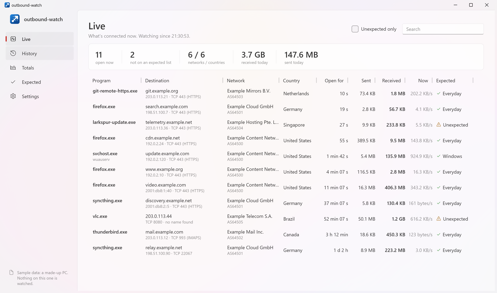
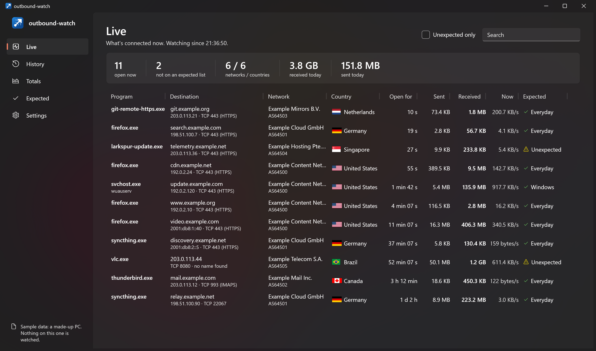
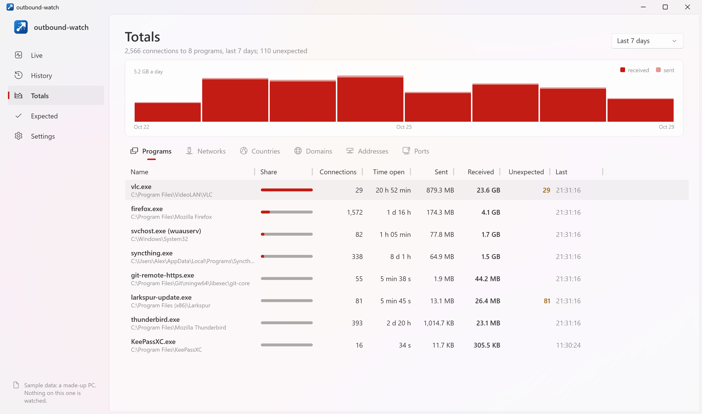
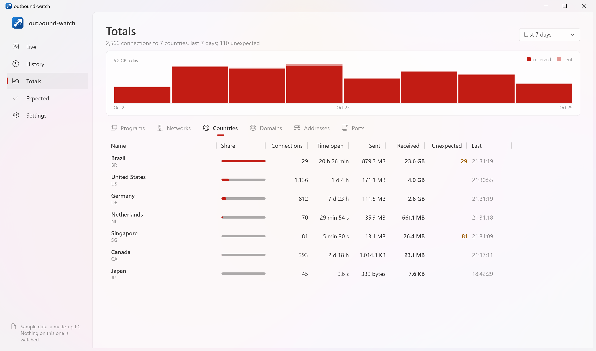
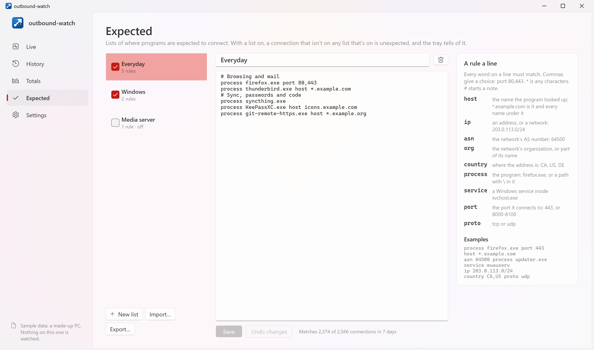
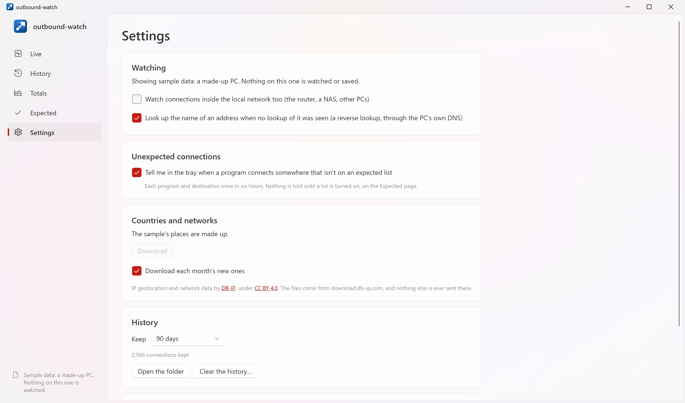

<p align="center">
  <a href="https://strongthium.com" title="Strongthium Labs"></a>
</p>

# outbound-watch

[](https://github.com/strongthium/outbound-watch/actions/workflows/release.yml)
[](https://github.com/strongthium/outbound-watch/releases/latest)
[](LICENSE)

`outbound-watch` is a Windows program that watches where your PC connects to. For every outgoing connection it shows
the program, the name that was looked up, the address, the network (AS number and organization) and the country, how
long the connection was open, and how much it sent and received. It shows them live and keeps them as history. You can write lists of the places you expect programs to connect to, and the tray tells you when one connects somewhere
else.

It runs on Windows 10 and 11, is one file of about 3 MB with nothing to install, and sends nothing about your connections anywhere.



The connections open now, each with its program, the name it looked up, its network and country, how long it has been
open, the bytes each way, and the expected list it's on. The pictures are of made-up sample data
(`outbound-watch --sample`): see [Using it](#using-it).

## What it shows

### Live



The connections open now, read again every second: the program (and for `svchost.exe`, the services in it), where
it goes, the network and country, the port, how long it has been open, the bytes sent and received, the rate now, and
whether it's on an expected list. Above them: how many are open, how many aren't expected, how many networks and
countries, and today's bytes. Click a column's heading to sort by it, and again to turn the order round. **Unexpected
only** and the search box narrow the list.

### History



Every connection open at any time in the last hour, today, the last 24 hours, 7 days, 30 days or all that's kept:
when it started and ended, and everything Live shows. Each one is judged against the expected lists as they are now,
so a rule added today also covers last week's connections.

### Totals



The history added up, by **program**, **network**, **country**, **domain** (`example.com` for `cdn.eu.example.com`),
**address** or **port**. For each: the connections, the time they were open, the bytes each way, a bar of its share,
and how many weren't expected. A chart above shows the bytes received and sent, by the hour or by the day. Double-click
a line to see its connections in the history.

### What can be done with a connection

Right-click any connection (or a line of the totals) for:

| | |
|---|---|
| **Expect this…** | adds a rule for it to an expected list: its name, any name in its domain, its address, its network, its country or anywhere, from that program (or service) only, on that port only |
| **History of this destination** | its connections over the last week (double-click does the same) |
| **Copy address**, **Copy name** | |
| **Show the program in Explorer** | |

## Expected lists



On the **Expected** page, a list is a rule a line. Every word on a line must match, and a word with commas matches any
of its values:

```
# Browsing and mail
process firefox.exe port 80,443
process thunderbird.exe host *.example.com
# Windows Update, from its own service
service wuauserv host *.example.com
asn 64500 process updater.exe
ip 203.0.113.0/24
country CA,US proto udp
```

| Word | Matches |
|---|---|
| `host` | the name the program looked up. `*.example.com` matches `example.com` and every name under it |
| `ip` | an address, or a network: `203.0.113.0/24`, `2001:db8::/32` |
| `asn` | the network's AS number: `64500` or `AS64500` |
| `org` | the network's organization, or part of its name; a pattern with `*` |
| `country` | where the address is: two letters, `CA` |
| `process` | the program: `firefox.exe`, or with a `\` in it, its path: `"C:\Program Files\Example\*"` |
| `service` | a Windows service inside `svchost.exe`: `Dnscache` |
| `port` | the port it connects to: `443`, or `8000-8100` |
| `proto` | `tcp` or `udp` |

`*` stands for any characters and `?` for one, and case doesn't matter. Everything after a `#` is a note. Lines that
can't be read are listed under the rules, with what's wrong.

Each list can be turned on or off. With no list on, nothing is judged. With one or more on, a connection that no list
that's on has a rule for is **unexpected**: it's marked on every page, and the tray tells you about it (each program
and destination once in six hours). Lists can be exported to a text file and imported from one.

A `host` rule matches only a name the PC looked up itself, never a name from a reverse lookup: that name is whatever
the address's owner chose, so anyone could name their address `something.example.com`.

## Administrator or not

It runs with the rights it's started with, and watches what those rights allow:

| | Without administrator rights | As administrator |
|---|---|---|
| **How** | reads Windows' table of TCP connections once a second (`GetExtendedTcpTable`), which any user can | also reads the kernel's own network events as they happen (ETW: `Microsoft-Windows-Kernel-Network`) |
| **TCP** | yes, except connections that open and close within a second | every one |
| **UDP** (QUIC, DNS, games, calls) | no | yes; a UDP "connection" ends after 2 minutes without a packet |
| **Bytes sent and received** | no | yes, per connection, and a chart of them by the hour |
| **Names** | a reverse lookup of the address (can be turned off) | the name each program looked up (ETW: `Microsoft-Windows-DNS-Client`), and Windows' DNS cache |

**Restart as administrator** (bottom left, or in Settings) starts it again with the rights; Windows asks first.

**Start outbound-watch in the tray when I sign in** (Settings): turned on while running as administrator, it's a task
in the Task Scheduler that starts it with those rights, and Windows doesn't ask at each sign-in. Turned on without
them, it's a value in your `Run` key, and it starts without them.

A connection is outgoing when this PC opened it: incoming connections (to a port that's listening here), loopback and
multicast are left out. Connections to the local network (the router, a NAS, other PCs) are left out unless
**Watch connections inside the local network too** is on.

## Countries and networks



An address's country and network come from [DB-IP](https://db-ip.com)'s free databases (*IP to Country Lite* and
*IP to ASN Lite*, under [CC BY 4.0](https://creativecommons.org/licenses/by/4.0/)). They are about 12 MB, downloaded
when you click **Download** (on Live or in Settings), kept on the PC, and updated each month unless you turn that off.
Every lookup is then done in memory: no address is ever sent anywhere to be looked up.

The country is where the address is used, which for a content network is often near you rather than where the company
is. Each country is shown with its flag; the flags are [Flagpedia](https://flagpedia.net)'s, which are in the public
domain, and are inside the program.

## Using it

Download a zip from [Releases](../../releases/latest), or take the `.exe` straight from [`public/`](public), which
always holds the latest build: `outbound-watch-win-x64-needs-dotnet.exe`, about 3 MB, for Windows 10 and 11 on x64
PCs. It runs on the [.NET 10 Desktop Runtime](https://dotnet.microsoft.com/download/dotnet/10.0) installed on the PC,
which Microsoft Update keeps patched. Without it, Windows offers to download it.

Closing the window leaves it watching in the tray; **Quit** is in the tray icon's menu. Starting it again shows the
copy that's running.

From the command line:

```
outbound-watch --minimized             # starts in the tray, as it does at sign-in
outbound-watch --data D:\watch         # keeps the history and databases there instead
outbound-watch --sample                # a made-up PC: nothing watched, nothing saved
outbound-watch --theme dark            # light or dark, rather than following Windows
outbound-watch --sample --view totals  # opens on live, history, totals, expected or settings
outbound-watch --sample --view totals --by country  # the totals by program, network, country, domain, address or port
```

The sample uses only the addresses, AS numbers and names set aside for documentation (`192.0.2.0/24`,
`198.51.100.0/24`, `203.0.113.0/24`, `2001:db8::/32`, AS64496 to AS64511, `example.com`, `.net` and `.org`), and
open-source programs, Windows' services and one made-up updater.

Some antivirus programs flag a new, unsigned program that reads the network and can start at sign-in with
administrator rights. If yours quarantines `outbound-watch`, check the file's `SHA256SUMS` and allow it there.

## About and updates

**About** (the last page down the side) says who makes `outbound-watch`, with links to Strongthium, and asks GitHub whether there's a newer version. If there is, **Update** downloads the release, checks it against the release's `SHA256SUMS`, replaces the program and starts it again. The history, lists and settings are in their own folder, and stay as they are. If the program's folder can't be changed without an administrator, it says so, and **What's new** leads to the release to download by hand. The checksums come with the release, so they catch a damaged download, not a tampered release.

GitHub is asked only when About is opened, again if it's still open an hour later, or when **Check again** is pressed. `api.github.com` sees that the question came from your address, and which program and version asked.

## Your data

Everything stays on the PC, in `%LocalAppData%\Strongthium\outbound-watch`: the history (`outbound-watch.db`, SQLite),
the expected lists, the settings and DB-IP's files. History is kept for 90 days unless you choose otherwise (7 days,
30 days, a year or everything). **Clear the history…** in Settings deletes it.

The only things it sends over the network are the download of DB-IP's files from `download.db-ip.com`, and, unless
you turn them off, reverse lookups of addresses through the PC's own DNS server, as `nslookup` would, and About's question to `api.github.com`, for the latest version. That one shows up among the connections too.

## Building

You need Windows and the [.NET 10 SDK](https://dotnet.microsoft.com/download).

```
.\build.ps1                 # tests, then the program into public\  (or double-click build.cmd)
.\build.ps1 -Bump revision  # the same as a new version: 1.0.0.0 -> 1.0.0.1
```

`build.ps1` runs the tests (`-SkipTests` skips them), publishes the program, and replaces what's in
[`public/`](public) with it, its `SHA256SUMS` and the `VERSION` it was built as.

The version is in [`VERSION`](VERSION), `major.minor.patch.revision`, and every build reads it. `-Bump major|minor|patch|revision` or
`-Version 2.0.0.0` builds a new one, and `VERSION` is changed once that build has succeeded, so the version in the
repository is always the one in `public/`.

For working on it:

```
dotnet build
dotnet test
dotnet run --project src/OutboundWatch -- --sample
```

| Folder | What's in it |
|---|---|
| [`src/OutboundWatch.Core`](src/OutboundWatch.Core) | the watcher: Windows' TCP table, the kernel's network and DNS events (ETW), the DNS cache, naming processes and services, DB-IP's databases, the expected lists' rules, the history (SQLite), the totals and the sample data |
| [`src/OutboundWatch`](src/OutboundWatch) | the window (WPF, with its Fluent theme) and the tray: Live, History, Totals, Expected and Settings |
| [`tests/OutboundWatch.Tests`](tests/OutboundWatch.Tests) | tests of the core: the rules, the addresses and databases, the tables' and events' bytes (made byte by byte here, since the real ones need administrator rights), the watcher fed made-up connections, and the history |
| [`public`](public) | the latest build, made by `build.ps1` |
| [`build.ps1`](build.ps1), [`build.cmd`](build.cmd), [`VERSION`](VERSION) | the builder, and the version it builds |

`master` holds the source. A push to `deploy` (a merge into it counts) runs
[`.github/workflows/release.yml`](.github/workflows/release.yml), which:

1. runs the tests on Windows;
2. builds the x64 program, one `.exe`;
3. publishes release `v<VERSION>` with its zip and `SHA256SUMS`. A version is released once: to release
   again, raise it first (`build.ps1 -Bump revision`).

## More from Strongthium

Strongthium Labs also makes software for running your own servers and talking to your customers, at [strongthium.com](https://strongthium.com):

<table>
  <tr>
    <td width="64" align="center" valign="top">
      <a href="https://strongthium.com/linux-server-firewall"><picture><source media="(prefers-color-scheme: dark)" srcset="https://raw.githubusercontent.com/strongthium/.github/main/profile/icons/dark/guard.svg"></picture></a>
    </td>
    <td valign="top">
      <a href="https://strongthium.com/linux-server-firewall"><b>Strongthium Guard</b></a><br>
      <sub><b>Linux server firewall.</b> Locks down your Linux servers, reads their logs and shuts out whoever attacks them, within seconds.</sub>
    </td>
    <td width="64" align="center" valign="top">
      <a href="https://strongthium.com/self-hosted-mail-server"><picture><source media="(prefers-color-scheme: dark)" srcset="https://raw.githubusercontent.com/strongthium/.github/main/profile/icons/dark/mail.svg"></picture></a>
    </td>
    <td valign="top">
      <a href="https://strongthium.com/self-hosted-mail-server"><b>Strongthium Mail</b></a><br>
      <sub><b>Self-hosted mail server for Linux and Windows.</b> Receives, checks and sends your mail, and tells you exactly why it refused what it refused.</sub>
    </td>
  </tr>
  <tr>
    <td width="64" align="center" valign="top">
      <a href="https://strongthium.com/self-hosted-live-chat"><picture><source media="(prefers-color-scheme: dark)" srcset="https://raw.githubusercontent.com/strongthium/.github/main/profile/icons/dark/chat.svg"></picture></a>
    </td>
    <td valign="top">
      <a href="https://strongthium.com/self-hosted-live-chat"><b>Strongthium Chat</b></a><br>
      <sub><b>Self-hosted live chat for Linux and Windows.</b> A chat on your websites and text messages in one inbox, answered from Windows or a browser.</sub>
    </td>
    <td width="64" align="center" valign="top">
      <a href="https://strongthium.com/windows-ssh-client"><picture><source media="(prefers-color-scheme: dark)" srcset="https://raw.githubusercontent.com/strongthium/.github/main/profile/icons/dark/remote.svg"></picture></a>
    </td>
    <td valign="top">
      <a href="https://strongthium.com/windows-ssh-client"><b>Strongthium Remote</b></a><br>
      <sub><b>Windows SSH client.</b> SSH terminal, file manager, editor, server task manager, database client and remote desktop in tabs, in one program.</sub>
    </td>
  </tr>
</table>

## License

MIT, see [LICENSE](LICENSE). The address data is DB-IP's, under CC BY 4.0; the flags are Flagpedia's, public domain.
