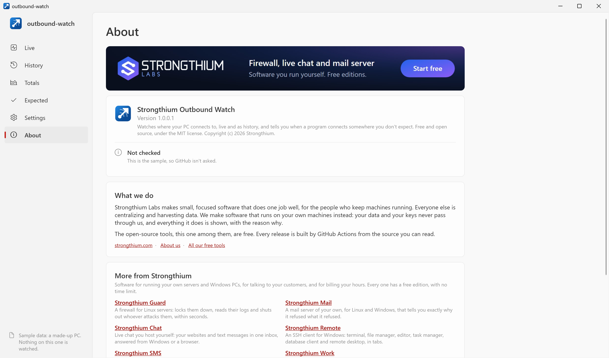
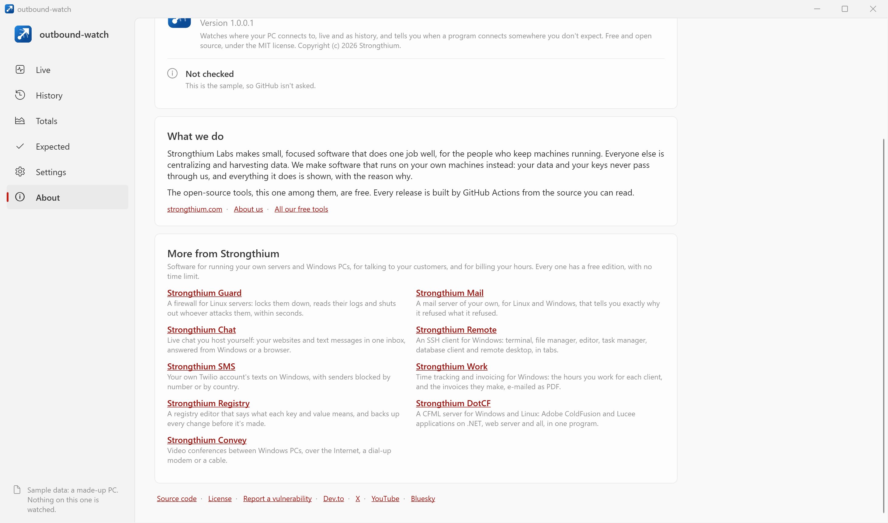

  

[outbound-watch](../README.md) › [Manual](README.md) › About

# About

Who makes `outbound-watch`, the version that runs, whether there's a newer one, and updating to it. **About** is the
last page down the side.

## Strongthium Outbound Watch

The banner at the top opens strongthium.com. Under it, the program's icon and name, **Version** and the version that
runs, and a line on what it does and its license.

## The update check

Under the version, what GitHub said:

| | |
|---|---|
| *Asking GitHub for the latest version…* | while it asks |
| *You have the latest version.* | nothing to do |
| *Version 1.0.0.2 is out. You have 1.0.0.1.* | with **Update to 1.0.0.2 and restart** and **What's new** |
| *This is newer than the latest release, 1.0.0.0.* | a build of your own, say |
| *Couldn't ask GitHub for the latest version* | and why: see [Messages](messages.md) |
| *Not checked* | in the sample: *This is the sample, so GitHub isn't asked.* |

GitHub is asked only when About is first shown, again when it's shown an hour or more after the last answer, and when
**Check again** is pressed: never in the background. The question goes to `api.github.com`, which sees that it came
from your address, and which program and version asked. It shows up among the connections too.

| | |
|---|---|
| **Update to … and restart** | downloads the release's zip from GitHub, checks it against the release's `SHA256SUMS`, puts the new `outbound-watch.exe` in place of this one and starts it. The history, the lists and the settings are in their own folder, and stay as they are |
| **What's new** | opens the release's page on GitHub, where it can also be downloaded by hand |
| **Check again** | asks GitHub again |

While it updates, it shows *Downloading version …* with a bar, then *Starting version …*. If the update can't be
installed, it says *The update wasn't installed* and why, and nothing is changed: a download that doesn't match the
checksums is never used, and if the new program won't start, the old one is put back. One reason is a
program folder that only an administrator can change (`C:\Program Files`, say): then download it with **What's new**,
and replace the program by hand. The checksums come with the release, so they catch a damaged
download, not a tampered release.

The old program is set aside as `outbound-watch.exe.old` while the new one starts, and deleted once it has.

## What we do, and More from Strongthium

**What we do** says what Strongthium Labs makes, with links to strongthium.com, **About us** and **All our free
tools**. **More from Strongthium** lists its other products, each a link to its page: Strongthium Guard, Mail, Chat,
Remote, SMS, Work, Registry, DotCF and Convey.

Under the cards: **Source code**, **License**, **Report a vulnerability**, **Dev.to**, **X**, **YouTube** and
**Bluesky**. Every link opens in your browser.

← [Settings](settings.md) · [Contents](README.md) · [The tray icon](tray.md) →

<!-- strongthium-links -->

---

<b>Strongthium open-source tools:</b> <a href="https://github.com/strongthium/emudhra-security-patch">eMudhra Security Patch</a> · <a href="https://github.com/strongthium/folder-size">Folder Size</a> · <a href="https://github.com/strongthium/health-reminder">Health Reminder</a> · <a href="https://github.com/strongthium/host-dossier">Host Dossier</a> · <b>Outbound Watch</b> · <a href="https://github.com/strongthium/raw-convert">RAW Convert</a> · <a href="https://github.com/strongthium/video-dispatch">Video Dispatch</a> · <a href="https://github.com/strongthium/webdav-server">WebDAV Server</a> 
<b>More from Strongthium:</b> <a href="https://strongthium.com/linux-server-firewall">Guard</a> · <a href="https://strongthium.com/self-hosted-mail-server">Mail</a> · <a href="https://strongthium.com/self-hosted-live-chat">Chat</a> · <a href="https://strongthium.com/windows-ssh-client">Remote</a> · <a href="https://strongthium.com/twilio-sms-desktop-app">SMS</a> · <a href="https://strongthium.com/time-tracking-invoicing-software">Work</a> · <a href="https://strongthium.com/windows-registry-editor">Registry</a> · <a href="https://strongthium.com/cfml-server">DotCF</a> · <a href="https://strongthium.com/video-conferencing-dial-up-modem">Convey</a> 
<a href="https://strongthium.com">Strongthium Labs</a> · Take back control of your internet.

