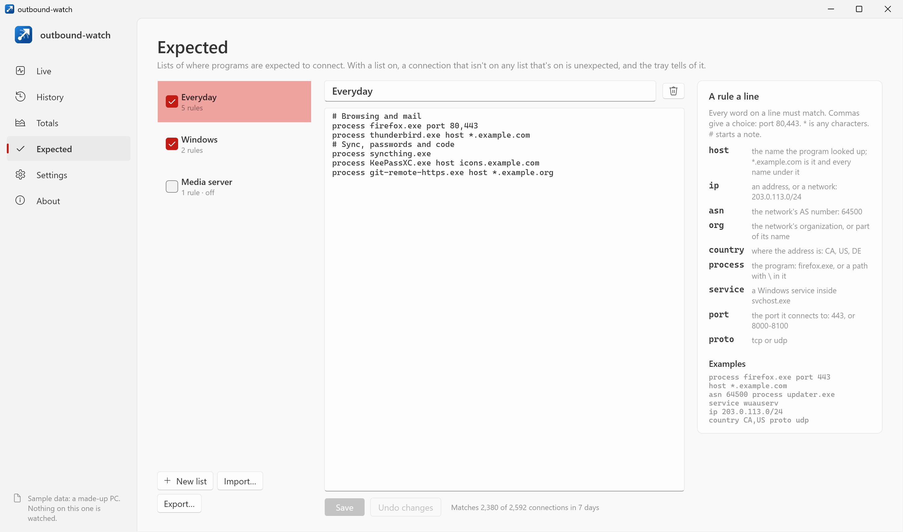

<p align="center">
  <a href="https://strongthium.com" title="Strongthium Labs"></a>
</p>

[outbound-watch](../README.md) › [Manual](README.md) › Expected

# Expected

Lists of where programs are expected to connect. With a list on, a connection that isn't on any list that's on is
**unexpected**: it's marked on every page, and the tray tells of it.



## The lists

On the left, each list with the number of its rules (*5 rules*, and *· off* when it's off).

| | |
|---|---|
| The box beside a list | turns it on or off, at once (*On: connections are judged by it*). A list that's off judges nothing |
| **New list** | adds a list called *New list* (*New list 2*, and so on), turned on, with an example rule as a note, and puts the cursor in its name |
| **Import…** | adds a list from a text file of rules (*Rules (\*.txt)*), named after the file. If some of its lines can't be read, it says how many, and they're marked under the rules |
| **Export…** | saves the list shown as a text file, with a first line `# outbound-watch expected list: <name>`, as it is in the editor |

With no list on, nothing is judged: there's no **Unexpected** anywhere, and the tray tells of nothing. With no list at
all, the page says *No list yet. Make one with New list, or right-click a connection on Live or History and choose
Expect this.*

## The list chosen

| | |
|---|---|
| The name | the list's name, as shown on the pages (in the **Expected** column) |
| The bin (*Delete the list*) | deletes the list, after asking (*Delete the list "Everyday"?*) |
| The rules | the list as text, a rule a line |
| The lines in red | each line that can't be read, and what's wrong with it: *Line 3: "hots" isn't one of host, ip, asn, org, country, process, service, port, proto.* A line that can't be read matches nothing; the others still work |
| **Save** | saves the name and the rules. The connections open now are judged again at once |
| **Undo changes** | goes back to the list as it was last saved |
| **Matches N of M connections in 7 days** | how many of the last 7 days' connections the list, as saved, has a rule for |

Choosing another list, **New list** or **Import…** with changes not saved asks *Save the changes to "Everyday"?*:
**Yes** saves them, **No** drops them, **Cancel** stays.

## How a rule is written

The card on the right, **A rule a line**, sums this up.

```
# Browsing and mail
process firefox.exe port 80,443
process thunderbird.exe host *.example.com
# Windows Update, from its own service
service wuauserv host *.example.com
asn 64500 process updater.exe
ip 203.0.113.0/24
country CA,US proto udp
org "Example Cloud"
process "C:\Program Files\Example\*"
```

A rule is pairs of a word and a value. Every pair on a line must match; a value with commas matches any of them
(`port 80,443`). `*` stands for any characters and `?` for one, and case doesn't matter. Everything after a `#` is a
note, and a line of only a note is skipped. A value with spaces goes in quotes.

| Word | Matches | Value |
|---|---|---|
| `host` | the name the program looked up | `www.example.com`, or a pattern. `*.example.com` matches `example.com` itself and every name under it |
| `ip` | the address | an address, or a network: `203.0.113.0/24`, `2001:db8::/32` |
| `asn` | the network's AS number | `64500` or `AS64500` |
| `org` | the network's organization | part of its name (`Example Cloud`), or a pattern with `*` or `?` for the whole of it |
| `country` | the country the address is used in | two letters: `CA` |
| `process` | the program | its file name (`firefox.exe`), or, with a `\` in it, its full path: `"C:\Program Files\Example\*"` |
| `service` | a Windows service inside `svchost.exe` | its name: `Dnscache`, `wuauserv` |
| `port` | the port it connects to | `443`, or a range: `8000-8100` |
| `proto` | the protocol | `tcp` or `udp` |

A connection is expected when any rule of any list that's on matches it, and the **Expected** column then names the
first such list.

### Why a host rule ignores reverse lookups

A `host` rule matches only a name the PC looked up itself, never a name from a reverse lookup: that name is whatever
the address's owner chose, so anyone could name their address `something.example.com`. A connection named only by a
reverse lookup is matched by its address, network or country instead.

### What can be wrong with a line

| | |
|---|---|
| *"…" isn't one of host, ip, asn, org, country, process, service, port, proto.* | a word that isn't one of the nine |
| *"port" needs a value after it.* | a word on its own at the end of the line |
| *"…" isn't an address or a network like 203.0.113.0/24.* | `ip` |
| *"…" isn't an AS number like 64500 or AS64500.* | `asn` |
| *"…" isn't a two-letter country code like CA.* | `country` |
| *"…" isn't a port like 443 or a range like 8000-8100.* | `port` |
| *"…" isn't tcp or udp.* | `proto` |
| *a quote isn't closed.* | a `"` without the one that ends it |

## The sample's lists

**Everyday** (Firefox, Thunderbird, Syncthing, KeePassXC and git), **Windows** (Windows Update and the time service)
and **Media server** (VLC, turned off), so that VLC and the made-up `larkspur-update.exe` are unexpected.

← [Expect this](expect-this.md) · [Contents](README.md) · [Settings](settings.md) →

<!-- strongthium-links -->

---

<p align="center"><sub>
<b>Strongthium open-source tools:</b> <a href="https://github.com/strongthium/emudhra-security-patch">eMudhra Security Patch</a> · <a href="https://github.com/strongthium/folder-size">Folder Size</a> · <a href="https://github.com/strongthium/health-reminder">Health Reminder</a> · <a href="https://github.com/strongthium/host-dossier">Host Dossier</a> · <b>Outbound Watch</b> · <a href="https://github.com/strongthium/raw-convert">RAW Convert</a> · <a href="https://github.com/strongthium/video-dispatch">Video Dispatch</a> · <a href="https://github.com/strongthium/webdav-server">WebDAV Server</a><br>
<b>More from Strongthium:</b> <a href="https://strongthium.com/linux-server-firewall">Guard</a> · <a href="https://strongthium.com/self-hosted-mail-server">Mail</a> · <a href="https://strongthium.com/self-hosted-live-chat">Chat</a> · <a href="https://strongthium.com/windows-ssh-client">Remote</a> · <a href="https://strongthium.com/twilio-sms-desktop-app">SMS</a> · <a href="https://strongthium.com/time-tracking-invoicing-software">Work</a> · <a href="https://strongthium.com/windows-registry-editor">Registry</a> · <a href="https://strongthium.com/cfml-server">DotCF</a> · <a href="https://strongthium.com/video-conferencing-dial-up-modem">Convey</a><br>
<a href="https://strongthium.com">Strongthium Labs</a> · Take back control of your internet.
</sub></p>
