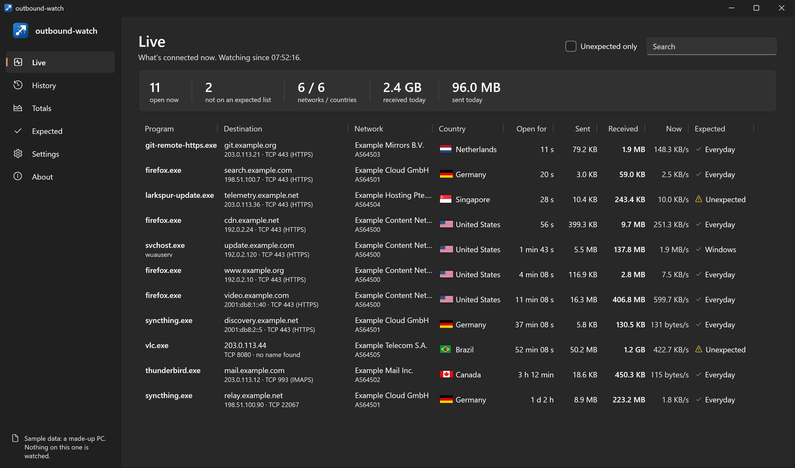

  

[outbound-watch](../README.md) › [Manual](README.md) › Installing and starting

# Installing and starting

`outbound-watch` is one file, `outbound-watch.exe`, of about 3 MB, for Windows 10 and 11 on x64 PCs. There is nothing
to install: put it in a folder of your own and run it.

## What it needs

The [.NET 10 Desktop Runtime](https://dotnet.microsoft.com/download/dotnet/10.0), which Microsoft Update keeps patched.
Without it, Windows offers to download it the first time the program is run.

## Where to get it

| | |
|---|---|
| **[Releases](../../../releases/latest)** | `outbound-watch-<version>-win-x64-needs-dotnet.zip`, with `outbound-watch.exe` in it, and `SHA256SUMS` to check it against |
| **[`public/`](../public)** | the latest build, `outbound-watch.exe`, straight from the repository |

Some antivirus programs flag a new, unsigned program that reads the network and can start at sign-in with
administrator rights. If yours quarantines `outbound-watch`, check the file against the release's `SHA256SUMS` and
allow it there.

## The first start

It opens on [Live](live.md), and starts watching at once. It follows Windows' light or dark mode (`--theme` sets one:
see [The command line](command-line.md)).

Two things make it see more:

1. **Restart as administrator**, at the bottom left. Without administrator rights it sees TCP only, and can't count
   bytes; with them it sees UDP too, and the bytes each connection sends and receives. Windows asks first. See
   [Administrator or not](administrator.md).
2. **Download**, on Live (or in [Settings](settings.md)). DB-IP's free address databases, about 12 MB, give each
   address its network and country. See [Countries and networks](countries-and-networks.md).

Then write what you expect on the [Expected](expected.md) page, or build it up from what you see: right-click a
connection and choose **Expect this…**. Until a list is turned on, nothing is called unexpected.

## Closing it, and quitting

Closing the window (its **X**) hides it: the watching goes on in the tray, and the tray says so the first time
(**Still watching**). To stop watching, choose **Quit (stop watching)** in the tray icon's menu. See
[The tray icon](tray.md).

When Windows shuts down, the connections open at that moment are saved as ending then.

## One copy at a time

One copy runs for each Windows user (and each data folder: see `--data` in [The command line](command-line.md)).
Starting it again while it runs shows the window of the copy that's running, rather than starting a second one.

## Starting at sign-in

**Start outbound-watch in the tray when I sign in**, in [Settings](settings.md), starts it at each sign-in, with the
window hidden in the tray. Turned on while it runs as administrator, it starts with those rights, from the Task
Scheduler, and Windows doesn't ask at each sign-in. Turned on without them, it starts without them.

## The sample

`outbound-watch --sample` shows a made-up PC instead of this one: a week of history, a few connections open now, and
three expected lists. Nothing on this PC is watched and nothing is saved. Every picture in this manual is of it. The
sample uses only the addresses, AS numbers and names set aside for documentation (`192.0.2.0/24`, `198.51.100.0/24`,
`203.0.113.0/24`, `2001:db8::/32`, AS64496 to AS64511, `example.com`, `.net` and `.org`), open-source programs,
Windows' services and one made-up updater, `larkspur-update.exe`. The bottom left of the window says
*Sample data: a made-up PC. Nothing on this one is watched.*

[Contents](README.md) · [Live](live.md) →

<!-- strongthium-links -->

---

<b>Strongthium open-source tools:</b> <a href="https://github.com/strongthium/emudhra-security-patch">eMudhra Security Patch</a> · <a href="https://github.com/strongthium/folder-size">Folder Size</a> · <a href="https://github.com/strongthium/health-reminder">Health Reminder</a> · <a href="https://github.com/strongthium/host-dossier">Host Dossier</a> · <b>Outbound Watch</b> · <a href="https://github.com/strongthium/raw-convert">RAW Convert</a> · <a href="https://github.com/strongthium/video-dispatch">Video Dispatch</a> · <a href="https://github.com/strongthium/webdav-server">WebDAV Server</a> 
<b>More from Strongthium:</b> <a href="https://strongthium.com/linux-server-firewall">Guard</a> · <a href="https://strongthium.com/self-hosted-mail-server">Mail</a> · <a href="https://strongthium.com/self-hosted-live-chat">Chat</a> · <a href="https://strongthium.com/windows-ssh-client">Remote</a> · <a href="https://strongthium.com/twilio-sms-desktop-app">SMS</a> · <a href="https://strongthium.com/time-tracking-invoicing-software">Work</a> · <a href="https://strongthium.com/windows-registry-editor">Registry</a> · <a href="https://strongthium.com/cfml-server">DotCF</a> · <a href="https://strongthium.com/video-conferencing-dial-up-modem">Convey</a> 
<a href="https://strongthium.com">Strongthium Labs</a> · Take back control of your internet.

