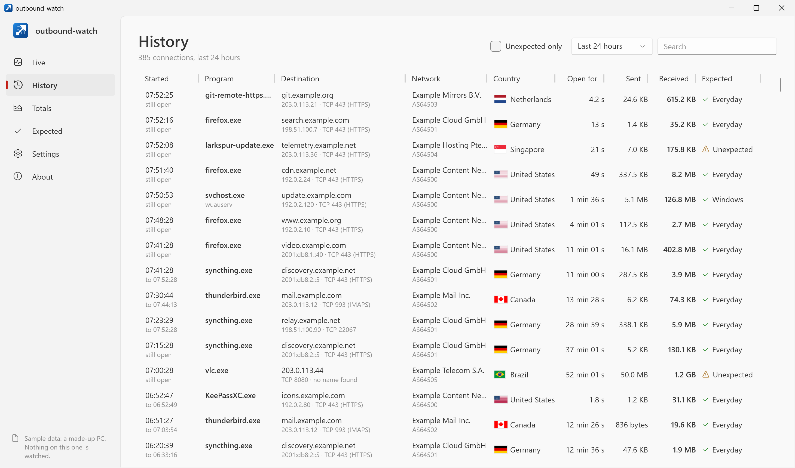

  

[outbound-watch](../README.md) › [Manual](README.md) › History

# History

Every connection open at any time in the time chosen, newest first: when it started and ended, the program, where it
went, how long it was open and the bytes each way. Each is judged against the expected lists as they are now, so a
rule added today also covers last week's connections.

## At the top

| | |
|---|---|
| **N connections, last 24 hours** | how many are shown, and for when. *(the latest 20,000)* after it: there were more, and only the latest 20,000 are shown; choose a shorter time, or search. *Reading…* while it reads them |
| **Unexpected only** | shows only the connections that aren't on an expected list that's on |
| The time | **Last hour**, **Today** (since midnight), **Last 24 hours**, **Last 7 days**, **Last 30 days** or **All that's kept**; **Last 24 hours** when the program starts. A connection is shown if it was open at any moment of that time, even if it started before it |
| **Search** | looks in the history as you stop typing, for the connections with it in their program, service, name, address, network's organization, country code (`DE`, not *Germany*), port or AS number (`AS64500`) |

## Only some connections

Coming from **History of this destination** on [Live](live.md), **Only this destination** here, or a line of
[Totals](totals.md), the page shows only those connections, and a card above the list says which: *Only
telemetry.example.net*. Its **×** (*Show every connection*) shows them all again. The search, **Unexpected only** and
the time still narrow what's shown.

A destination is its name when it has one (every connection to that name, whatever its address), or else its address.
From a destination, the time is set to **Last 7 days**; from a line of the totals, to the time the totals were for.

## The columns

| | |
|---|---|
| **Started** | when it started: the time alone for today, the day and time before (`Oct 28, 21:04`). Under it, *to* and when it ended, or *still open* |
| **Program**, **Destination**, **Network**, **Country** | as on [Live](live.md) |
| **Open for** | how long it was open. *≥* in front: it was already open when watching began |
| **Sent**, **Received** | its bytes. **—** for a connection watched without administrator rights |
| **Expected** | the list it's on now, or **Unexpected**. Empty when no list is on |

Click a column's heading to sort by it, and again to turn the order round, as on Live.

## Using it

| | |
|---|---|
| **Double-click** a connection | only its destination, over the last 7 days |
| **Right-click** a connection | **Expect this…**, **Only this destination**, **Copy address**, **Copy name** and **Show the program in Explorer**: see [Right-click a connection](connection-menu.md) |

How long the history is kept, and how to clear it, is in [Settings](settings.md).

← [Live](live.md) · [Contents](README.md) · [Totals](totals.md) →

<!-- strongthium-links -->

---

<b>Strongthium open-source tools:</b> <a href="https://github.com/strongthium/emudhra-security-patch">eMudhra Security Patch</a> · <a href="https://github.com/strongthium/folder-size">Folder Size</a> · <a href="https://github.com/strongthium/health-reminder">Health Reminder</a> · <a href="https://github.com/strongthium/host-dossier">Host Dossier</a> · <b>Outbound Watch</b> · <a href="https://github.com/strongthium/raw-convert">RAW Convert</a> · <a href="https://github.com/strongthium/video-dispatch">Video Dispatch</a> · <a href="https://github.com/strongthium/webdav-server">WebDAV Server</a> 
<b>More from Strongthium:</b> <a href="https://strongthium.com/linux-server-firewall">Guard</a> · <a href="https://strongthium.com/self-hosted-mail-server">Mail</a> · <a href="https://strongthium.com/self-hosted-live-chat">Chat</a> · <a href="https://strongthium.com/windows-ssh-client">Remote</a> · <a href="https://strongthium.com/twilio-sms-desktop-app">SMS</a> · <a href="https://strongthium.com/time-tracking-invoicing-software">Work</a> · <a href="https://strongthium.com/windows-registry-editor">Registry</a> · <a href="https://strongthium.com/cfml-server">DotCF</a> · <a href="https://strongthium.com/video-conferencing-dial-up-modem">Convey</a> 
<a href="https://strongthium.com">Strongthium Labs</a> · Take back control of your internet.

