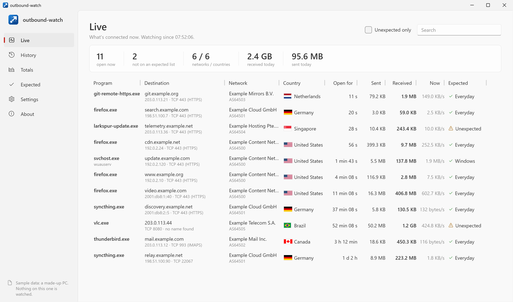

  

[outbound-watch](../README.md) › [Manual](README.md) › Live

# Live

The connections open now, read again every second while the page shows: each with its program, where it goes, the
network and country, how long it has been open, the bytes each way, the rate now and the expected list it's on.

## At the top

| | |
|---|---|
| **What's connected now. Watching since…** | when watching began. With **Unexpected only** or a search narrowing the list, it says how many of the open connections are shown instead: *4 of 11 open connections* |
| **Unexpected only** | shows only the connections that aren't on an expected list that's on |
| **Search** | narrows the list as you type, to the connections with it in their program, service, name, address, network or country name; or that are exactly an AS number (`AS64500`), a country code (`DE`) or a port (`443`) |

## The totals now

| | |
|---|---|
| **open now** | the outgoing connections open at this moment |
| **not on an expected list** | how many of them aren't on a list that's on. With no list on, it's **—** and says *no expected list is on* |
| **networks / countries** | how many different networks (AS numbers) and countries they go to |
| **received today**, **sent today** | the bytes since midnight, from the history, read again every few seconds. **—** without administrator rights, when bytes aren't counted |

## The columns

| | |
|---|---|
| **Program** | the program's file name. Under `svchost.exe`, the Windows services running in it (`wuauserv`). Hover over it for the program's full path. `System` is Windows itself; `PID 1234` is a program whose name couldn't be read (one that had already quit, or that the rights it runs with can't open) |
| **Destination** | the name the program looked up, or the address when no name is known. Under it: the address and the port, with what the port is usually for (`TCP 443 (HTTPS)`, `UDP 443 (QUIC)`, `TCP 993 (IMAPS)`...). *reverse lookup* marks a name that came from asking for the address's name, rather than one the program looked up; *no name found* marks a connection with none |
| **Network** | the organization of the network the address is in, with its AS number under it. **—** before the address databases are downloaded |
| **Country** | the country the address is used in, with its flag. Hover over it for the two-letter code |
| **Open for** | how long it has been open. *≥* in front: it was already open when watching began, so it's been open at least that long |
| **Sent**, **Received** | the bytes it has sent and received. **—** without administrator rights |
| **Now** | the bytes a second, over the last second; empty when it's quiet |
| **Expected** | a tick and the name of the list it's on, or a warning sign and **Unexpected**. Empty when no list is on |

Sizes are written as Windows writes them, in units of 1,024: `56.7 KB`, `1.2 GB`. Times open: `8.4 s`, `42 s`,
`3 min 05 s`, `2 h 07 min`, `1 d 2 h`.

## Sorting

The newest connection is at the top. Click a column's heading to sort by it, and again to turn the order round.
**Open for**, **Sent**, **Received**, **Now** and **Expected** start with the largest (or the unexpected) first; the
others start from A.

## Using it

| | |
|---|---|
| **Double-click** a connection | its destination's history over the last 7 days, on [History](history.md) |
| **Right-click** a connection | **Expect this…**, **History of this destination**, **Copy address**, **Copy name** and **Show the program in Explorer**: see [Right-click a connection](connection-menu.md) |

A connection appears when it opens and goes when it ends. A UDP "connection" (the packets between one port here and
one address and port there) ends after two minutes without a packet. Which connections are watched, and which are left
out, is in [Administrator or not](administrator.md).

## Before the address databases are downloaded

A card at the top says *To see each address's network and country, download DB-IP's free address databases: about 12
MB, kept on this PC and updated monthly. After that, nothing is looked up online.*, with **Download**. While it
downloads, the card says what it's doing (*Downloading the countries…*, *Downloading the networks…*, *Reading them…*),
and when the program starts, *Reading the address databases…* until they're read. See
[Countries and networks](countries-and-networks.md).

← [Installing and starting](getting-started.md) · [Contents](README.md) · [History](history.md) →

<!-- strongthium-links -->

---

<b>Strongthium open-source tools:</b> <a href="https://github.com/strongthium/emudhra-security-patch">eMudhra Security Patch</a> · <a href="https://github.com/strongthium/folder-size">Folder Size</a> · <a href="https://github.com/strongthium/health-reminder">Health Reminder</a> · <a href="https://github.com/strongthium/host-dossier">Host Dossier</a> · <b>Outbound Watch</b> · <a href="https://github.com/strongthium/raw-convert">RAW Convert</a> · <a href="https://github.com/strongthium/video-dispatch">Video Dispatch</a> · <a href="https://github.com/strongthium/webdav-server">WebDAV Server</a> 
<b>More from Strongthium:</b> <a href="https://strongthium.com/linux-server-firewall">Guard</a> · <a href="https://strongthium.com/self-hosted-mail-server">Mail</a> · <a href="https://strongthium.com/self-hosted-live-chat">Chat</a> · <a href="https://strongthium.com/windows-ssh-client">Remote</a> · <a href="https://strongthium.com/twilio-sms-desktop-app">SMS</a> · <a href="https://strongthium.com/time-tracking-invoicing-software">Work</a> · <a href="https://strongthium.com/windows-registry-editor">Registry</a> · <a href="https://strongthium.com/cfml-server">DotCF</a> · <a href="https://strongthium.com/video-conferencing-dial-up-modem">Convey</a> 
<a href="https://strongthium.com">Strongthium Labs</a> · Take back control of your internet.

