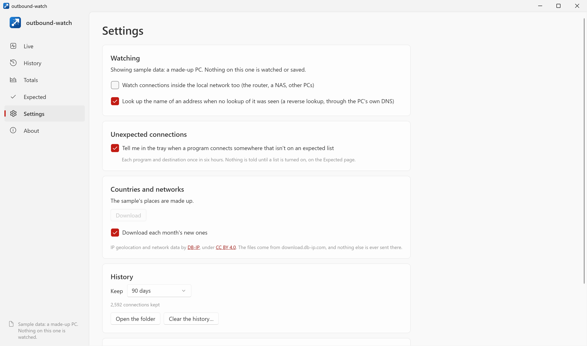

  

[outbound-watch](../README.md) › [Manual](README.md) › Settings

# Settings

What's watched and how, the tray's warnings, the address databases, the history kept, and starting at sign-in. Every
setting takes effect at once; there's nothing to save.

## Watching

| | |
|---|---|
| The first line | what's being watched. As administrator: *Running as administrator: every TCP and UDP connection is watched, with the bytes it sends and receives, from Windows' own network events. Names come from the DNS lookups as they happen.* Without: *Without administrator rights, outbound-watch reads Windows' table of TCP connections once a second. It can't count bytes, see UDP (QUIC, DNS, games, calls), or see connections shorter than a second.*, and why |
| **Restart as administrator** | starts it again with administrator rights; Windows asks first. Shown only without them. See [Administrator or not](administrator.md) |
| **Watch connections inside the local network too (the router, a NAS, other PCs)** | off: connections to private addresses (`10.x`, `172.16-31.x`, `192.168.x`, `100.64-127.x`, `169.254.x`, `fe80::`, `fc00::` to `fdff::`) are left out |
| **Look up the name of an address when no lookup of it was seen (a reverse lookup, through the PC's own DNS)** | on: a connection with no name after a few seconds has its address's name asked of the PC's DNS server, as `nslookup` would. Such a name is marked *reverse lookup*, and `host` rules ignore it |

## Unexpected connections

| | |
|---|---|
| **Tell me in the tray when a program connects somewhere that isn't on an expected list** | on: the tray shows a warning for each new unexpected connection, each program and destination once in six hours. Nothing is told until a list is turned on, on the [Expected](expected.md) page. See [The tray icon](tray.md) |

## Countries and networks

| | |
|---|---|
| The first line | *Not downloaded…*, or which month's databases it has and how many address ranges are in them: *DB-IP's databases of 2026-11: 1,234,567 address ranges, in …* |
| **Download**, **Update now** | downloads this month's files (last month's, early in a month before the new ones are out), and starts using them. Beside it, what it's doing, then *Done.* or *Couldn't download them:* and why |
| **Download each month's new ones** | on: when the program starts from the 3rd of a month on, and its files are of an earlier month, it downloads the new ones |

The line under them credits DB-IP, under CC BY 4.0, and says *The files come from download.db-ip.com, and nothing else
is ever sent there.* See [Countries and networks](countries-and-networks.md).

## History

| | |
|---|---|
| **Keep** | **7 days**, **30 days**, **90 days** (until it's changed), **A year** or **Everything**. Connections that ended before that are deleted when it starts, and every six hours while it runs |
| *N connections kept, in …* | how many connections the history holds, and the folder it's in |
| **Open the folder** | opens that folder in Explorer |
| **Clear the history…** | deletes every connection in the history, and the bytes a minute, after asking (*Delete every connection in the history? The expected lists and settings stay.*). The connections open now stay |

## Starting

| | |
|---|---|
| **Start outbound-watch in the tray when I sign in** | starts it at each sign-in, in the tray (`--minimized`) |

The line under it says how:

| | |
|---|---|
| *Without administrator rights. Turned on while running as administrator, it starts with them, so that bytes and UDP are watched.* | turned on now, it's a value called `Strongthium outbound-watch` in your `Run` key (`HKEY_CURRENT_USER\Software\Microsoft\Windows\CurrentVersion\Run`), and it starts without administrator rights |
| *With administrator rights, from the Task Scheduler: Windows doesn't ask at each sign-in.* | running as administrator, turned on now, it's a task called `Strongthium outbound-watch` in the Task Scheduler, run at your sign-in with the highest rights you have |
| *It starts with administrator rights, from the Task Scheduler: turning it off needs them too.* | the task is there, but this copy runs without administrator rights, so the box can't be changed. Restart as administrator to turn it off |

Each time it starts (except with `--data`), it points the value or the task at the `outbound-watch.exe` that's running, in case the program
was moved.

At the bottom, the version that runs, the license and where the source is: `outbound-watch 1.0.0.1 · MIT license · github.com/strongthium/outbound-watch`.

## In the sample

The sample shows *Showing sample data: a made-up PC. Nothing on this one is watched or saved.* and *The sample's places
are made up.*; the download, **Open the folder** and starting at sign-in do nothing there.

← [Expected](expected.md) · [Contents](README.md) · [About](about.md) →

<!-- strongthium-links -->

---

<b>Strongthium open-source tools:</b> <a href="https://github.com/strongthium/emudhra-security-patch">eMudhra Security Patch</a> · <a href="https://github.com/strongthium/folder-size">Folder Size</a> · <a href="https://github.com/strongthium/health-reminder">Health Reminder</a> · <a href="https://github.com/strongthium/host-dossier">Host Dossier</a> · <b>Outbound Watch</b> · <a href="https://github.com/strongthium/raw-convert">RAW Convert</a> · <a href="https://github.com/strongthium/video-dispatch">Video Dispatch</a> · <a href="https://github.com/strongthium/webdav-server">WebDAV Server</a> 
<b>More from Strongthium:</b> <a href="https://strongthium.com/linux-server-firewall">Guard</a> · <a href="https://strongthium.com/self-hosted-mail-server">Mail</a> · <a href="https://strongthium.com/self-hosted-live-chat">Chat</a> · <a href="https://strongthium.com/windows-ssh-client">Remote</a> · <a href="https://strongthium.com/twilio-sms-desktop-app">SMS</a> · <a href="https://strongthium.com/time-tracking-invoicing-software">Work</a> · <a href="https://strongthium.com/windows-registry-editor">Registry</a> · <a href="https://strongthium.com/cfml-server">DotCF</a> · <a href="https://strongthium.com/video-conferencing-dial-up-modem">Convey</a> 
<a href="https://strongthium.com">Strongthium Labs</a> · Take back control of your internet.

