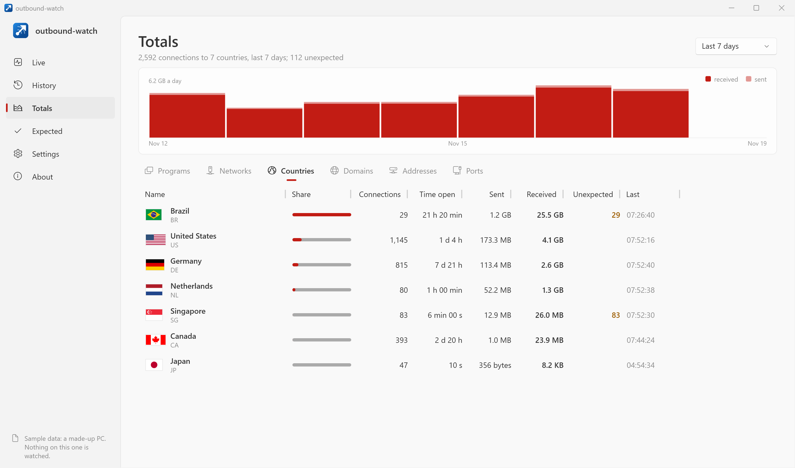

  

[outbound-watch](../README.md) › [Manual](README.md) › Totals

# Totals

The history added up: the bytes over the time chosen, as a chart, and by program, network, country, domain, address or
port, the connections, the time they were open, the bytes each way and how many weren't expected.

## At the top

| | |
|---|---|
| **N connections to M countries, last 7 days; K unexpected** | what's added up, and for when. *Adding up…* while it reads the history |
| The time | **Last hour**, **Today**, **Last 24 hours**, **Last 7 days**, **Last 30 days** or **All that's kept**; **Last 7 days** when the program starts |

## The chart

The bytes received (in the accent colour) and sent (paler, on top of them), a bar a step:

| The time chosen | A bar |
|---|---|
| up to 2 hours | 2 minutes |
| up to 2 days | an hour |
| longer | a day, from midnight |

The largest bar's bytes are written at the top left, and the times along the bottom: the start, the middle and the
end. **All that's kept** starts at the first connection in the history. With no bytes counted in the time, it says
*No bytes counted in this time (they're counted when it runs as administrator).*

## Added up by

| | A line | Under its name |
|---|---|---|
| **Programs** | a program, by its path: `svchost.exe (wuauserv)` for a service | the program's folder |
| **Networks** | a network (an AS number), by its organization's name. **Local network** for connections inside it, **Unknown network** for addresses no database knows | the AS number |
| **Countries** | a country, with its flag. **Unknown country** for addresses no database places | the two-letter code |
| **Domains** | a domain, as a person would say it: `example.com` for `cdn.eu.example.com`, `example.co.uk` for `www.example.co.uk`. A connection with no name is a line of its own address | the one name in it, or how many (*3 names*); *no name* for an address |
| **Addresses** | an address | the name it was connected to by |
| **Ports** | a port, with what it's usually for: `TCP 443 (HTTPS)` | |

## The columns

| | |
|---|---|
| **Name** | the line, as above |
| **Share** | a bar of its bytes, against the line with the most. When no bytes were counted, of its time open, against the line open longest |
| **Connections** | how many connections it's made of |
| **Time open** | their times open, added up, within the time chosen |
| **Sent**, **Received** | their bytes: all of each connection's, even one that began before the time chosen. **—** when none were counted |
| **Unexpected** | how many of its connections aren't on an expected list that's on, judged by the lists as they are now |
| **Last** | when the latest of them was last open |

The lines start with the most bytes first (the **Share** column). Click a column's heading to sort by it, and again to
turn the order round: **Name** starts from A, the others with the largest first.

## Using it

| | |
|---|---|
| **Double-click** a line | its connections, on [History](history.md), for the same time |
| **Right-click** a line | **Show these connections** (the same), and **Expect this…**: see [Right-click a connection](connection-menu.md) |

## Ports it names

`TCP 443 (HTTPS)`, `UDP 443 (QUIC)`, `80 (HTTP)`, `53 (DNS)`, `TCP 853 (DNS over TLS)`, `UDP 123 (NTP)`,
`TCP 22 (SSH)`, `TCP 25`, `465` and `587 (SMTP)`, `TCP 993 (IMAPS)`, `TCP 995 (POP3S)`, `TCP 143 (IMAP)`,
`TCP 445 (SMB)`, `TCP 3389 (Remote Desktop)`, `3478` and `19302 (STUN)`, `TCP 5222` and `5223 (XMPP / push)`,
`TCP 5228 (push)`, `1194 (OpenVPN)`, `UDP 51820 (WireGuard)` and `TCP 9418 (git)`. Others are just the protocol and
the number: `TCP 22067`.

← [History](history.md) · [Contents](README.md) · [Right-click a connection](connection-menu.md) →

<!-- strongthium-links -->

---

<b>Strongthium open-source tools:</b> <a href="https://github.com/strongthium/emudhra-security-patch">eMudhra Security Patch</a> · <a href="https://github.com/strongthium/folder-size">Folder Size</a> · <a href="https://github.com/strongthium/health-reminder">Health Reminder</a> · <a href="https://github.com/strongthium/host-dossier">Host Dossier</a> · <b>Outbound Watch</b> · <a href="https://github.com/strongthium/raw-convert">RAW Convert</a> · <a href="https://github.com/strongthium/video-dispatch">Video Dispatch</a> · <a href="https://github.com/strongthium/webdav-server">WebDAV Server</a> 
<b>More from Strongthium:</b> <a href="https://strongthium.com/linux-server-firewall">Guard</a> · <a href="https://strongthium.com/self-hosted-mail-server">Mail</a> · <a href="https://strongthium.com/self-hosted-live-chat">Chat</a> · <a href="https://strongthium.com/windows-ssh-client">Remote</a> · <a href="https://strongthium.com/twilio-sms-desktop-app">SMS</a> · <a href="https://strongthium.com/time-tracking-invoicing-software">Work</a> · <a href="https://strongthium.com/windows-registry-editor">Registry</a> · <a href="https://strongthium.com/cfml-server">DotCF</a> · <a href="https://strongthium.com/video-conferencing-dial-up-modem">Convey</a> 
<a href="https://strongthium.com">Strongthium Labs</a> · Take back control of your internet.

